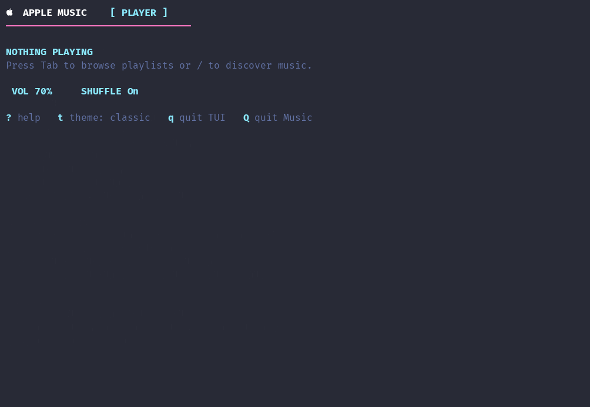

# Apple Music TUI


[](https://github.com/lynicis/apple-music-tui/releases/latest)

Manage Apple Music right from your terminal while you vibe code. Written in pure Swift.

---

## Demo



## Table of contents

- [Features](#features)
- [Requirements](#requirements)
- [Installation](#installation)
  - [Uninstall](#uninstall)
- [Usage](#usage)
  - [Keyboard shortcuts](#keyboard-shortcuts)
  - [Themes](#themes)
  - [Searching](#searching)
  - [Queue](#queue)
- [Configuration](#configuration)
- [How it works](#how-it-works)
- [Troubleshooting](#troubleshooting)
- [Development](#development)
- [Acknowledgements](#acknowledgements)
- [License](#license)

## Features

- **Player view** — current track, artist, album, playback state, volume, shuffle, elapsed time, duration, and a progress bar. No box is drawn around the interface, so the text reflows cleanly in narrow terminals.
- **Hidden Music window** — launches Music in the background and hides its windows after every command.
- **Two metadata sources** — queries AppleScript first and falls back to the system-wide "now playing" session through the `mediaremote-adapter` Swift package when streamed-track metadata or timing is unavailable.
- **Safely scoped fallback** — the fallback is only used when the session really belongs to Music (bundle identifier `com.apple.Music`, or a title that matches what AppleScript reported), so a video playing in Safari is never shown as Music.
- **Smoothed timing** — interpolates between stale elapsed-time samples without resetting the clock on a repeated `0` sample, so the progress bar keeps moving between one-second polls.
- **Playlist browser** — browse your user playlists with case-insensitive vim-style `/` filtering.
- **Library search** — search your own library by track, artist, or album with `t`, and play the selected track by persistent ID.
- **Catalog search** — search Apple's public iTunes catalog, including songs not added to your local library, and open the selected track in Music.
- **Queue view** — press `u` in the player to see the playlist Music is playing from, in order, with the track playing right now marked `▶`, and step along it with `n` / `p`.
- **Four colour themes** — `classic`, `mono`, `ocean`, and `sunset`; press `t` in the player to cycle and the choice is remembered.
- **Resilient terminal I/O** — uses retryable POSIX writes, including `EAGAIN`/`EWOULDBLOCK` backpressure, rather than Foundation `FileHandle.write`, which can raise an uncaught Objective-C exception on a momentarily full nonblocking terminal.
- **Non-blocking UI** — input and rendering stay responsive even when AppleScript or a catalog request stalls, because every slow call runs on a worker queue.

## Requirements

- macOS 13 or newer with the Music app
- Swift 5.9 or newer (Swift 6 is supported)
- Apple Music
- Automation permission for the terminal app running apple-music-tui

The MediaRemote adapter used for streamed tracks is supplied by the `mediaremote-adapter` package dependency and built by SwiftPM, so no Homebrew install is required for it.

## Installation

Install the latest release (Apple silicon or Intel):

```sh
curl -fsSL https://raw.githubusercontent.com/lynicis/apple-music-tui/master/install.sh | bash
```

Or build from source with Swift Package Manager:

```sh
git clone https://github.com/lynicis/apple-music-tui.git
cd apple-music-tui
swift build -c release
swift run apple-music-tui
```

Or run the built executable directly:

```sh
swift build -c release
./.build/release/apple-music-tui
```

To launch it from anywhere, link it into a directory that is already on your `PATH` (this usually needs `sudo`):

```sh
sudo ln -sf "$PWD/.build/release/apple-music-tui" /usr/local/bin/apple-music-tui
apple-music-tui
```

The built binary needs `libMediaRemoteAdapter.dylib` and the `MediaRemoteAdapter_MediaRemoteAdapter.bundle` resource, which SwiftPM leaves next to it in `.build/release`. If you copy the executable elsewhere, copy both alongside it.

### Uninstall

```sh
curl -fsSL https://raw.githubusercontent.com/lynicis/apple-music-tui/master/uninstall.sh | bash
```

Removes the binary, `libMediaRemoteAdapter.dylib`, and the adapter's resource bundle from wherever the installer put them. Your Music library and the saved theme in `~/.config/apple-music-tui` are left in place.

## Usage

```sh
swift run apple-music-tui
```

apple-music-tui must run in an interactive terminal; it exits with a message if stdin or stdout is not a TTY.

### Keyboard shortcuts

| Key | Action |
| --- | --- |
| `Space` | Play or pause |
| `n` / `p`, `→` / `←` | Next / previous track |
| `f` / `b` | Seek forward / back 10 seconds |
| `+` / `-` | Increase / decrease volume |
| `s` | Toggle shuffle |
| `t` | Cycle colour theme (player); search your library tracks (library) |
| `Tab` / `l` | Open playlists / return to the player |
| `/` | Search the Apple Music catalog (player); filter playlists or search library tracks (library) |
| `j` / `k`, arrow keys | Move the selection |
| `Enter` | Play the selected track or playlist; applies the playlist filter while typing |
| `Esc` | Close the help panel, cancel a search, clear the filter, or go back |
| `?` | Open the keyboard/control guide; press `?` or `Esc` to close it |
| `u` | Open the queue: the playlist Music is playing from |
| `q` | Exit apple-music-tui and leave Music running |
| `Q` | Quit Music and exit |

### Themes

Press `t` in the player to cycle through `classic`, `mono`, `ocean`, and `sunset`. The choice is written to `~/.config/apple-music-tui/theme` and restored on the next launch.

### Queue

Press `u` in the player to open the queue. It lists the playlist Music is playing from — the same list `n` / `p` walk — in playing order, marking the track playing right now with `▶`. `j` / `k` or the arrow keys move the cursor, `n` / `p` move playback to the next and previous track, and `Esc` or `l` returns to the player.

The queue view is read-only, on purpose. Music scripts no access to Up Next, so the only list it can show is the playlist being played, and that list can only be read or stepped through: starting a chosen track with `play <track>` leaves Music with no current playlist at all (the view would then have nothing to read), and `delete <track>` also removes Apple Music tracks from your library. Jumping and removing stay in Music's own controls: **Song ▸ Play Next**, **Song ▸ Add to Queue**, **Song ▸ Remove from Playlist**, **Song ▸ Delete from Library**.

### Searching

- **Catalog** — press `/` in the player, type a query, and press `Enter`. Results come from Apple's public iTunes Search API (`itunes.apple.com`). Selecting one opens it in Music; if a copy already exists in your library, yours is played instead.
- **Library tracks** — press `Tab` to open the library, then `t` (or `/`) to search your own tracks by name, artist, or album.
- **Playlists** — from the library screen, press `/` to filter your playlists by name and `Enter` to play the selection.

## Configuration

| Setting | Default | Description |
| --- | --- | --- |
| `MUSICTUI_COUNTRY` | `TR` | Storefront country code used for catalog search, e.g. `US`, `GB`, `DE`. |
| `~/.config/apple-music-tui/theme` | `classic` | Remembered theme name, written by pressing `t`. |

```sh
MUSICTUI_COUNTRY=US swift run apple-music-tui
```

## How it works

- **Playback control goes through MediaRemote.** Play/pause, next, previous, seek, and shuffle are sent to the system media session through the [`mediaremote-adapter`](https://github.com/ejbills/mediaremote-adapter) Swift package, so they no longer spawn `osascript`.
- **AppleScript covers what MediaRemote can't.** Volume, playlists, library search, specific-track playback, quitting Music, the queue view (which reads the playlist Music is playing from), and hiding the Music window all go through `/usr/bin/osascript`, and the now-playing read uses AppleScript first with MediaRemote repairing missing or stale fields.
- **MediaRemote fills the gaps.** On macOS 15.4 and later MediaRemote is restricted to entitled processes, so AppleScript can stop returning track properties or playback timing for streamed tracks. For those cases apple-music-tui reads the system-wide now-playing session through the [`mediaremote-adapter`](https://github.com/ejbills/mediaremote-adapter) Swift package, which builds the adapter library and drives it through the system Perl interpreter (`/usr/bin/perl`). The `nowplaying-cli` executable is never invoked, and no Homebrew install is needed.
- **The fallback is verified before use.** Because the adapter reports the system-wide session, the result is discarded unless it belongs to Music, and the track title must match the AppleScript title when one is available. Its timestamp-adjusted position is what lets reopening apple-music-tui mid-song resume at the real position instead of `0:00`.
- **Timing is interpolated.** The display advances elapsed time between polls and deliberately does not reset the interpolation anchor when a stale sample repeats, so the progress bar keeps moving.
- **Idle polling backs off.** Playback is polled once a second while something is playing or while you are typing, and every three seconds once a player is left paused and untouched, so an open window stops spawning `osascript` for no reason.
- **Threading.** Input and rendering run on the main loop; every AppleScript, Perl, and network call runs on a worker queue and reports back through a mailbox. The main run loop is serviced between polls so the adapter's main-queue callbacks can run.
- **Output.** Frames are written with POSIX `write` in a retry loop that handles `EINTR` and waits on `poll` for `EAGAIN`/`EWOULDBLOCK`, instead of using Foundation `FileHandle.write`. The frame is double-buffered: only rows that changed are retyped, each positioned and erased to end of line, so a shorter row can never leave a stale tail behind.

MediaRemote relies on private macOS APIs and may change after OS updates. If neither source provides timing, apple-music-tui displays `--:--` rather than inventing a time.

## Troubleshooting

| Symptom | Cause and fix |
| --- | --- |
| `apple-music-tui needs an interactive terminal.` | stdin or stdout is not a TTY. Run the binary directly in a terminal rather than through a pipe or a non-interactive shell. |
| Nothing plays after selecting a catalog result | The track may be unavailable for your account or region. The status line says the playback could not be confirmed; press `Tab` then `t` to search your library for a copy. |
| Timing shows `--:--` | Neither AppleScript nor MediaRemote reported timing. Check that the terminal app has Automation permission under System Settings → Privacy & Security → Automation. |
| Catalog search returns no results | The storefront may not carry the track. Set `MUSICTUI_COUNTRY` to your storefront, e.g. `MUSICTUI_COUNTRY=US`. |
| Music window reappears | Hiding windows needs Automation permission for System Events; grant it, then restart apple-music-tui. |
| macOS asks for permission on first run | Grant Automation access for Music and System Events, so apple-music-tui can control playback and hide the window. |

## Development

```sh
make test          # swift test
make build         # swift build -c release
make run           # swift run apple-music-tui
make clean         # swift package clean
```

`make` with no target runs `test` and then `build`. The test suite covers terminal output backpressure, AppleScript response parsing, the MediaRemote snapshot mapping and validation, playlist/track search plumbing, volume and shuffle state handling, frame rendering and double-buffering, and theme persistence (`swift test` runs 52 tests).

Layout:

```text
Sources/MusicTUI/            executable entry point
Sources/MusicTUICore/        model, terminal runtime, view, playback, catalog
  PlaybackController.swift   AppleScript + MediaRemote controller
  TerminalRuntime.swift      raw-mode terminal session, event loop, workers
  TerminalView.swift         frame rendering
  AppModel.swift             UI state and key handling
  Theme.swift                colour themes and persistence
Tests/MusicTUICoreTests/     XCTest suite
demo/demo.cast               asciinema recording used in this README
demo/demo.gif                rendered from that recording
```

## Acknowledgements

- [`ejbills/mediaremote-adapter`](https://github.com/ejbills/mediaremote-adapter) — the Swift package this project depends on to read the now-playing session; a fork of [`ungive/mediaremote-adapter`](https://github.com/ungive/mediaremote-adapter). Both are licensed under the BSD 3-Clause License.
- [`kirtan-shah/nowplaying-cli`](https://github.com/kirtan-shah/nowplaying-cli) — the earlier source of the MediaRemote helper this project used to require.

## License

[MIT](https://github.com/lynicis/apple-music-tui/blob/master/LICENSE) © 2026 Emre Sırmalı.

The bundled `mediaremote-adapter` dependency is distributed separately under the BSD 3-Clause License.
